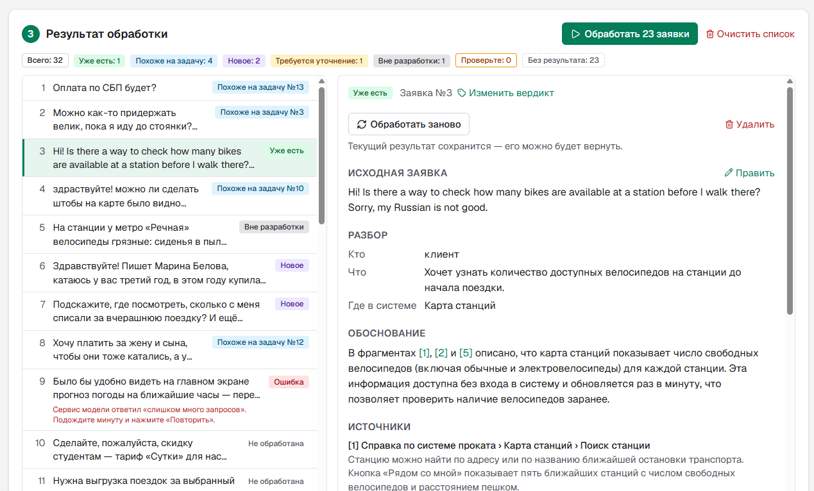
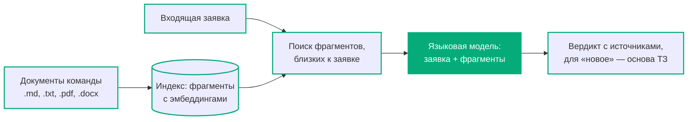

<h1><picture>
  <source media="(prefers-color-scheme: dark)" srcset="docs/logo-dark.svg">
  
</picture></h1>

AI-ассистент, который помогает преобразовать пожелания пользователей в структурированные требования и подготовить основу для технического задания.

## Что это и зачем

**Проблема.** Пожелания пользователей приходят пачками и сформулированы по-разному: «хочу, чтобы напоминало об оплате», «присылайте письмо, если абонемент кончается». Аналитик для каждого вспоминает или ищет: может, это уже есть; может, такую задачу уже заводили; к какому модулю это относится. Только потом пишет ТЗ — и снова ищет, что уточнить у автора.

**Чего не хватает привычным инструментам.** Поиск в трекере и вики идёт по словам: по запросу «заморозить абонемент» он не найдёт задачу «Приостановка абонемента». А когда находит, выдаёт список ссылок — решать, есть ли такое уже, к какому модулю это относится и что написать в ТЗ, всё равно аналитику. Поиск похожих обращений в службе поддержки сравнивает обращения между собой, а не с документацией и списком задач.

**Для кого.** Сотрудник, который разбирает входящие заявки пользователей, — аналитик, владелец продукта, руководитель проекта или администратор службы поддержки (далее в документах проекта — аналитик). Нужны документы о своей системе: справка, прежние ТЗ, список задач, глоссарий.

**Почему AI и почему не обычный чат.** Языковая модель хорошо переформулирует и раскладывает текст по шаблону, но не знает вашу систему и придумает несуществующие модули. Wish2Spec сначала находит в ваших документах фрагменты, близкие по смыслу к заявке, и даёт модели только их. Близость считается по эмбеддингам — векторам смысла текста (см. «Как устроено», шаг 2); такой подход — найти фрагменты и дать их модели — называют RAG. Вердикт — «уже есть», «похоже на задачу №…», «новое», «требуется уточнение», «вне разработки» — всегда с источниками, которые можно проверить. Поэтому Wish2Spec работает только вместе с документами команды: без них ему не на что опереться.



*Результат обработки на других тестовых данных (вымышленный велопрокат): заявки с разными вердиктами, заявка на английском с разбором по-русски, источники, пояснение к ошибке сервиса и ещё не обработанные заявки.*

## Технологии и почему

Подробно, с отвергнутыми вариантами, — в [журнале решений](docs/decisions-log.md).

- **Next.js (App Router) + TypeScript + Tailwind CSS** — интерфейс и серверная часть в одном проекте. Сервер нужен: ключ языковой модели нельзя держать в браузере.
- **AI SDK v6 + `@ai-sdk/openai-compatible`** — подходит любой OpenAI-совместимый сервис (Vercel AI Gateway, OpenRouter, OpenAI): достаточно вписать свой адрес, ключ и модель. Версия 6 работает и на Node 20, 7-я требует Node 22.
- **Локальные эмбеддинги — `@huggingface/transformers`** с моделью `Xenova/multilingual-e5-small` (многоязычная, понимает русский, лицензия MIT). Бесплатно и без лимитов, документы при индексации не покидают компьютер, кроме `npm install` ничего ставить не нужно. Есть запасной режим — эмбеддинги через тот же сервис по ключу.
- **`mammoth` и `unpdf`** — текст из DOCX (с заголовками Word) и из PDF. Файлы разбираются на сервере, библиотеки не попадают в код страницы; обе работают на Node 20.
- **zod** — проверка настроек и входных данных на сервере.
- **`lucide-react`** — значки на кнопках; в сборку попадают только используемые.
- **Хранение — JSON-файлы в папке `data/`** (не попадает в репозиторий). Деплоя нет, приложение работает локально.

## Как устроено



Путь от документов до основы ТЗ по шагам:

1. **Документы режутся на фрагменты.** Форматы — `.md`, `.txt`, `.pdf` (с текстовым слоем) и `.docx`. Markdown — по заголовкам: каждый раздел — отдельный фрагмент, длинный раздел делится по абзацам примерно до 1200 символов, раздел короче 100 символов склеивается с соседним. DOCX режется так же — по заголовкам Word («Заголовок 1», «Заголовок 2»…). `.txt` и PDF — по абзацам. В начало фрагмента добавляется путь заголовков: «Справка по модулям › Абонементы › Приостановка абонемента».
2. **Каждый фрагмент превращается в эмбеддинг** — вектор смысла текста (локальная модель `multilingual-e5-small`). Индекс хранится в `data/index.json`.
3. **Входящие заявки** разбиваются по пустой строке (если пустых строк нет — по строкам) и сохраняются в `data/requests.json`. Английские заявки тоже разбираются: две английские заявки контрольного набора в итоговом замере разобраны верно, но проверка маленькая, а другие языки не проверяли.
4. **Для каждой заявки** считается её эмбеддинг и находятся до 6 ближайших по смыслу фрагментов; фрагменты, совсем далёкие от заявки (близость ниже порога), отбрасываются. Порог подобран под локальную модель и действует только в режиме `EMBEDDINGS_MODE=local`; в режиме `api` фрагменты не отбрасываются. Длинная заявка (больше 1200 символов) ищется по частям: модель эмбеддингов читает только начало текста, а главное в письме часто стоит в конце. У каждого фрагмента берётся лучшая оценка по частям, модели уходит полный текст заявки, вердикт один.
5. **Модель получает заявку и эти фрагменты с номерами** и отвечает строго по схеме: разбор (кто, что, где в системе), вердикт, номер задачи для «похоже», обоснование со ссылками [1], [2] и номера источников. Номера, которых не было среди фрагментов, сервер отбрасывает. Если в документах ничего не нашлось, модель всё равно разбирает заявку, но выбрать может только «новое», «вне разработки» или «требуется уточнение».
6. **Для вердикта «новое»** второй вызов модели готовит основу ТЗ: название · исходная заявка (дословно, её вставляет код) · проблема и цель · сценарий · критерии приёмки · затронутые модули — только из найденных фрагментов, со ссылками, иначе «связей не найдено» · открытые вопросы (к автору или к команде — решает аналитик).
7. **Карточка заявки** показывает вердикт, разбор, обоснование, источники, основу ТЗ и подсказку «Что дальше»; основу ТЗ и вопросы можно скопировать в Markdown.

**«Кто» в разборе** — роль автора заявки (клиент, администратор и т. п.), которую модель определяет по тексту самой заявки; если из текста не ясно — «не указано». Это догадка модели, код её не проверяет. Имени и контакта автора Wish2Spec не знает: в заявке есть только её текст.

**Ключевые модули:**

- нарезка документов — `lib/chunking.ts`, текст из PDF и DOCX — `lib/extract.ts`;
- эмбеддинги (локальная модель или сервис) — `lib/embeddings.ts`;
- поиск ближайших фрагментов и порог — `lib/search.ts`;
- обработка заявки: поиск, вызов модели, проверка ответа, отметка «Проверьте», основа ТЗ — `lib/process.ts`; подключение к модели — `lib/llm.ts`, настройки из `.env.local` — `lib/config.ts`;
- промпты — `lib/prompts.ts`;
- хранение в JSON-файлах `data/` — `lib/store.ts`;
- проверка ввода — `lib/input.ts` (лимиты и их сообщения — `lib/limits.ts`), защита маршрутов от запросов с чужих сайтов и по чужому адресу — `lib/guard.ts`;
- тексты ошибок для аналитика — `lib/errors.ts`; ярлыки вердиктов, отметка «Проверьте» и «Что дальше» — `lib/verdicts.ts`; тексты для копирования — `lib/markdown.ts`;
- маршруты `app/api/*`: `documents` — документы (список, загрузка, удаление); `requests` — заявки (список, добавление, правки аналитика, удаление); `requests/process` — обработка одной заявки; `requests/spec` — «Подготовить основу ТЗ»; `demo` — демо-данные; `dev/check` и `dev/measure` — маршрут проверки подключений и маршрут замера, только при `npm run dev`;
- интерфейс — `app/page.tsx` и `components/*`: три шага и очередь обработки — `workspace.tsx`, шаги — `documents-step.tsx`, `requests-step.tsx`, `results-step.tsx`, карточка заявки — `request-card.tsx`.

**Отметка «Проверьте».** Её ставит код, а не модель, — рядом с ярлыком вердикта в карточке (ниже — строка с причиной) и в списке заявок. Причины: номера задачи из вердикта нет в найденных фрагментах (вердикт остаётся, но номер мог быть указан ошибочно); вердикт «похоже на задачу», но номер не указан; связей в документах не найдено (вердикт — только по тексту заявки). Отметка показывает слабое место ответа, но не проверяет его на все ошибки: вердикт без отметки тоже бывает неверным — на контрольном наборе v0.2 ни одна ошибочная заявка отметку не получила (замер — в [DEV_NOTES.md](DEV_NOTES.md)). Если аналитик сменил вердикт вручную, отметка снимается: её причины относятся к ответу модели.

**Работа с результатом.** Карточка — не только просмотр: аналитик исправляет результат AI на месте, и правки сохраняются.

- **«Обработать»** — в карточке заявки, которую ещё не обрабатывали: обрабатывает только её. Так срочную заявку можно разобрать раньше остальных.
- **«Изменить вердикт»** — выбрать один из пяти, для «похоже на задачу» — указать номер задачи; «Что дальше» меняется вместе с вердиктом. Основу ТЗ можно **«Править»** как текст в Markdown, «Копировать» берёт исправленный текст. У исправленного вердикта и исправленной основы ТЗ — пометка «изменено вручную», под исправленным вердиктом — каким был вердикт AI.
- **«Подготовить основу ТЗ»** — для заявки с любым вердиктом: модель готовит основу ТЗ по источникам из карточки, как для «новое».
- **Текст заявки можно поправить («Править» у «Исходная заявка») и нажать «Обработать заново»** — например, дописать ответ автора на вопросы «Уточнить у пользователя». Текущий результат вместе с правками сохраняется как прежний вариант (об этом напоминает строка у кнопки), и в карточке появляется кнопка **«Вернуть прежний вариант»** — она меняет текущий и прежний местами. До первой повторной обработки прежнего варианта нет, и кнопки тоже нет. Хранится один прежний вариант. «Обработать заново» есть и без правки текста.
- **«Копировать для трекера»** у «похоже на задачу» с указанным номером задачи — заявка и номер задачи, а если задача есть в источниках — где о ней написано; **«Копировать ответ»** у «уже есть» — короткий ответ автору, где найти функцию: разделы документов, где она описана (источники, где упомянута задача («Задача №N»), в ответ не попадают: обычно это внутренний список задач команды). Оба текста собираются по шаблону, без вызова модели.
- **«Показать целиком»** — источник в карточке показывается началом фрагмента, кнопка раскрывает его.
- **Счётчики над списком** — всего заявок, по каждому вердикту и с отметкой «Проверьте» (с учётом правок аналитика); заявки без результата (не обработаны или с ошибкой) — отдельным счётчиком. Счётчики — ещё и фильтры: нажатие оставляет в списке только эти заявки, повторное нажатие или «Всего» снимает фильтр. Открытая карточка остаётся, даже если заявка не попала в фильтр. «Обработать N заявок» по-прежнему обрабатывает все необработанные заявки, а не только видные в списке.
- **Ошибка сервиса модели** показывается понятным текстом в строке и в карточке — например, «слишком много запросов»: подождать минуту. Кнопка **«Повторить»** отправляет заявку снова. Текст ошибки и код ответа сервиса пишутся в терминал запуска — окно, где выполнена команда `npm run dev`, — без текстов заявок и документов.
- **«Удалить»** у заявки, **«Очистить список»** и **«Удалить все документы»** — с подтверждением. Готовые карточки после удаления документов не меняются: источники в них — копии фрагментов.

Страница отправляет заявки на обработку по одной и сразу показывает готовые; ошибка одной заявки не останавливает остальные. Пока идёт «Обработать N заявок», рядом есть **«Остановить»**: заявка, которая уже обрабатывается, доходит до конца, а остальные возвращаются в прежнее состояние — «Не обработана» или «Ошибка»; их можно обработать позже, списком или по одной из карточки. Промпты — в `lib/prompts.ts`.

**Что куда отправляется.** Документы разбиваются на фрагменты и превращаются в эмбеддинги на вашем компьютере (в режиме `EMBEDDINGS_MODE=local`). В сервис языковой модели уходят текст заявки (полностью) и найденные к ней фрагменты — об этом напоминает строка внизу шага «2. Входящие заявки». В режиме `EMBEDDINGS_MODE=api` в сервис уходят и все фрагменты документов — для расчёта эмбеддингов.

**Ограничения.**

- Поиск по смыслу находит не всё: заявка про «сертификат в подарок» не находит задачу «Подарочный абонемент», хотя эта пара есть в глоссарии, — модель эмбеддингов не считает эти слова близкими. Близость к нужным и к лишним фрагментам у неё почти одинаковая, поэтому порог отсекает только текст, совсем далёкий от документов. Заявка, про которую в документах ничего нет, обычно всё равно получает фрагменты, и строки «Связей в документах не найдено» у неё нет — проверяйте источники в карточке сами.
- В длинном письме просьба, окружённая подробным рассказом, может не найтись: части письма с рассказом дают близость выше.
- PDF разбирается без заголовков: путь источника — только название документа, таблицы извлекаются неаккуратно. Сканы без текстового слоя не читаются — Wish2Spec сообщит, что в файле нет текста. Для точной нарезки лучше DOCX или Markdown.
- Одну заявку в несколько строк (например, заголовок и описание) нельзя добавить отдельно от других: без пустых строк каждая строка становится отдельной заявкой. Если вставить её вместе с другими заявками через пустую строку, она останется одной.

## Термины и вердикты

- **Входящая заявка** (коротко — заявка) — то, что прислал пользователь системы: письмо, сообщение из чата, строка таблицы.
- **Задача** — то, что команда уже завела в трекере (в демо — файл «Список задач»).
- **Трекер** — трекер задач команды: Jira, YouTrack и подобные.
- **Основа ТЗ** — то, что готовит Wish2Spec для новой заявки; аналитик проверяет и дописывает её.
- **Фрагмент** — кусок документа, по которому ищутся связи с заявкой; **источник** — фрагмент, на который опирается вывод.

Вердикты:

| Вердикт | Когда | Что дальше |
|---|---|---|
| Уже есть | Функция уже работает: описана в справке или в задаче со статусом «Готово» | Ответить автору, где найти эту функцию |
| Похоже на задачу №N | Есть ещё не сделанная задача о том же | Добавить заявку к задаче — ещё один голос за неё |
| Новое | Такого нет, но это решается доработкой программы, даже если подходящего модуля нет | Проверить основу ТЗ, решить открытые вопросы с автором или командой, завести задачу |
| Требуется уточнение | Из заявки не понять, чего хочет автор | Отправить автору вопросы |
| Вне разработки | Программой не решается: парковка, цены, работа сотрудников | Передать тем, кто за это отвечает, или ответить автору |

## Пограничные случаи

| Случай | Что делает Wish2Spec | Подробнее |
|---|---|---|
| Документы не загружены | Обработка неактивна, рядом подсказка «Сначала загрузите документацию системы.» | — |
| В документах нет ничего по теме заявки | Фрагменты ниже порога близости отбрасываются. Если не осталось ни одного — строка «Связей в документах не найдено», отметка «Проверьте», а вердикт — только «новое», «вне разработки» или «требуется уточнение». Срабатывает редко: порог отсекает только текст, совсем далёкий от документов (на контрольном наборе — у 1 из 5 заявок без связей). Остальные получают фрагменты — проверяйте источники | «Как устроено», шаг 4; «Ограничения» |
| Просьба, которую программой не решить | Вердикт «вне разработки» | «Термины и вердикты» |
| Непонятная заявка («не работает») | Вердикт «требуется уточнение» и 2–4 вопроса автору; ответ можно дописать в заявку и нажать «Обработать заново» | «Работа с результатом» |
| Текст не о системе | Отсекается порогом не всегда: «погода в Москве» — ниже порога (как в строке «В документах нет ничего по теме заявки»), а «рецепт борща» порог прошёл. Тогда модель получает лишние фрагменты — проверяйте источники | «Ограничения» |
| Очень короткая заявка | Обрабатывается как обычная, но порог может отрезать нужный фрагмент: на контрольном наборе так было у заявки из трёх слов | — |
| Очень длинная заявка | До 5000 символов; длиннее 1200 — поиск по частям. Просьба среди подробного рассказа может не найтись | «Как устроено», шаг 4; «Ограничения» |
| Модель указала несуществующий источник, модуль или номер задачи | Номера источников, которых не было среди фрагментов, сервер отбрасывает; модуль в основе ТЗ без ссылки на фрагмент — тоже; номер задачи, которого нет в найденных фрагментах, получает отметку «Проверьте» | «Как устроено», шаги 5–6; «Отметка «Проверьте»» |
| Модель ошиблась в свободном тексте | «Кто», «Где в системе», обоснование и сценарий основы ТЗ код с документами не сверяет. Ссылки [1], [2] ведут к источникам, «Показать целиком» открывает фрагмент — проверяйте по ним | «Работа с результатом» |
| Ответ модели не по схеме | Сервис получает строгую схему, сервер проверяет ответ ещё раз и при несовпадении повторяет запрос один раз; потом — ошибка и «Повторить» | «Запуск» |
| Просьбы к модели внутри текста заявки | Текст заявки передаётся модели как данные: промпт велит не выполнять написанное в нём, а границы заявки в промпте подделать нельзя | `lib/prompts.ts` |
| Большие файлы и много данных | Лимиты размера, сообщения называют файл или номер заявки. Проверено на наборах из 5–6 документов (десятки фрагментов); сотни документов не замерялись: индекс — один JSON-файл, который читается целиком при обработке каждой заявки | «На документах своей системы» |
| Файл без текста, скан, другая кодировка | Скан и файл без текста — сообщение, что текста нет; файл не в UTF-8 загрузится нечитаемым текстом | «Ограничения»; «На документах своей системы» |
| Ошибка сервиса модели | Понятный текст в строке и в карточке, кнопка «Повторить»; ошибка одной заявки не останавливает остальные | «Работа с результатом» |

**Качество.** На контрольном наборе из 24 заявок, которых не было при подборе промптов и порога, вердикт совпал с ожидаемым у 22–23 заявок (по разным прогонам), на демо-заявках — у 11 из 12. Замеры — в [DEV_NOTES.md](DEV_NOTES.md), v0.2 и v0.3.

## Запуск

Нужен **Node.js 20.9 или новее** (проверено на 20.11.1) и ключ OpenAI-совместимого сервиса языковой модели. Модель должна поддерживать структурированный ответ по JSON-схеме (`response_format: json_schema`), иначе обработка каждой заявки закончится ошибкой.

1. Установить зависимости:
   ```bash
   npm install
   ```
   На Node 20 младше 20.19 npm может написать `EBADENGINE` про пакет линтера `eslint-visitor-keys` — на работу приложения и линтера это не влияет (проверено на 20.11.1). `ExperimentalWarning` в терминале — уведомление о способе чтения JSON (библиотекой модели эмбеддингов), который в ранних версиях Node ещё считается экспериментальным.
2. Скопировать `.env.example` в `.env.local` и заполнить значения — что означает каждая переменная, написано в самом файле. Все обязательны, кроме `LLM_REASONING_EFFORT` и `EMBEDDINGS_API_MODEL` (нужна только при `EMBEDDINGS_MODE=api`). Для начала оставьте `EMBEDDINGS_MODE=local`, как в образце: эмбеддинги считаются на вашем компьютере, ключ для них не нужен. Приложение проверялось с моделью `alibaba/qwen3.7-flash` через Vercel AI Gateway (`LLM_BASE_URL=https://ai-gateway.vercel.sh/v1`). Для «рассуждающей» модели рекомендуется `LLM_REASONING_EFFORT=none`: на демо-заявках вердиктов, совпавших с ожидаемыми, столько же, сколько с `low`, а ответ в разы быстрее (замер — в [DEV_NOTES.md](DEV_NOTES.md), v0.1). Если чего-то не хватает или значение в неверном формате, маршрут проверки подключений (ниже) назовёт эти переменные; если сервис отклонит ключ или модель — покажет его ответ.
3. Запустить:
   ```bash
   npm run dev
   ```
   и открыть http://localhost:3003. Приложение открывается только на компьютере, где оно запущено, — другие устройства в сети его не видят. Если порт 3003 занят, можно выбрать другой:
   ```bash
   npm run dev -- -p 4000
   ```
   Тогда и в адресах ниже вместо 3003 — ваш порт, а замерам (см. «Как попробовать») его передают так: `npm run measure:quality -- --port 4000`.

Локальная модель эмбеддингов скачивается с Hugging Face один раз (около 135 МБ) в папку `data/models/` — при первом расчёте эмбеддингов: при проверке подключений, `npm run check:embeddings` или первой загрузке документов, смотря что будет раньше.

**Резервная копия.** Данные — в двух файлах: `data/requests.json` (заявки, результаты и правки) и `data/index.json` (документы и их эмбеддинги). Скопировать их можно и при запущенном приложении. Чтобы восстановить, остановите приложение (Ctrl+C в терминале запуска), положите файлы обратно в папку `data/` проекта, запустите его снова и обновите страницу: иначе обработка, которая шла в этот момент, может записать свои данные поверх копии, а открытая страница до обновления показывает прежние данные. В `.env.local` при этом должны быть те же `EMBEDDINGS_MODE` и `EMBEDDINGS_API_MODEL`: эмбеддинги в `index.json` посчитаны этой моделью. Если модель другая, удалите документы и загрузите их заново — заявки и результаты из `requests.json` останутся. Папку `data/models/` копировать не нужно — модель скачается снова.

**Маршрут проверки подключений.** При запущенном `npm run dev` скопируйте в адресную строку браузера адрес http://localhost:3003/api/dev/check: модель ответит на короткий вопрос по-русски, а для трёх фраз посчитаются эмбеддинги. В production-сборке (после `npm run build` и `npm start`) этот адрес отвечает 404. Отдельно проверить только локальные эмбеддинги, без ключа:

```bash
npm run check:embeddings
```

## Как попробовать

В папке `demo/` — документы вымышленной студии йоги и 12 входящих заявок.

1. Запустите проект (раздел «Запуск») и откройте http://localhost:3003. Тема — светлая или тёмная, как в настройках системы; переключатель — справа в шапке, выбор запоминается в браузере.
2. **«1. Документация системы»** → **«Загрузить демо-данные»**. Кнопка видна, пока нет ни документов, ни заявок. Она загружает пять документов из `demo/` и 12 входящих заявок из `demo/Входящие заявки.txt`; обработку не запускает. В первый раз скачивается модель эмбеддингов (около 135 МБ). В шаге 1 появится строка «5 документов, 45 фрагментов» — нажмите на неё, чтобы увидеть список документов; в шаге 3 — 12 заявок.

   То же можно сделать вручную: в шаге 1 «Загрузить файлы» → выберите в `demo/` пять файлов: «Справка по модулям.md», «ТЗ Лист ожидания на занятие.md», «ТЗ Онлайн-оплата абонемента.md», «Список задач.md», «Глоссарий.txt»; в шаге **«2. Входящие заявки»** «Загрузить .txt» → `demo/Входящие заявки.txt`. Появится строка «Входящие заявки.txt — найдено 12» (нажатие раскрывает список заявок, «Отменить» убирает файл) → «Добавить 12 заявок в список». Заявки можно и вставить в поле: под ним появится «Введено вручную: N».
3. Нажмите на любую строку в шаге **«3. Результат обработки»** — откроется карточка заявки, а в ней «Обработать»: так обрабатывается одна заявка. Остальные — кнопкой «Обработать 11 заявок» над списком. Заявки обрабатываются по одной, у каждой строки виден статус, готовые получают ярлык вердикта. Пока идёт обработка, её можно прервать кнопкой «Остановить». Счётчики над списком — фильтры: например, «Новое: 3» оставит в списке только заявки с этим вердиктом.
4. Нажмите на строку с готовым результатом — справа (на узком экране — ниже) откроется карточка: разбор, обоснование, источники, для «новое» — основа ТЗ с кнопками «Копировать» (вся основа) и «Копировать вопросы» (только раздел «Открытые вопросы»). В карточке можно сменить вердикт, поправить основу ТЗ или текст заявки и обработать её заново (см. «Работа с результатом»).

Какие вердикты ожидаются для демо-заявок — в `demo/Ожидаемые вердикты.json`. В демо есть заявки, написанные словами пользователя, а не терминами системы (например, «заморозить абонемент»): связь с документами для них находится через глоссарий.

**На документах своей системы.** Загрузите справку, прежние ТЗ, список задач и глоссарий в `.md`, `.txt`, `.docx` или `.pdf`. Лучше всего работают документы с заголовками — Markdown (`#`, `##`) или DOCX со стилями заголовков Word: по ним документ режется на разделы. PDF режется только по абзацам (см. «Ограничения»). Файл PDF или DOCX — до 10 МБ, в распакованном виде — до 100 МБ (картинки не считаются; у обычного документа столько не бывает), текст документа — до 500 000 символов; заявка — до 5000 символов; при превышении Wish2Spec назовёт файл или номер заявки. У задач в списке — заголовок вида `## Задача №N. Название` и под ним строка `Статус: …` (вердикт «похоже на задачу» берёт номер из заголовка; по статусу «Готово» модель отличает уже сделанную задачу — пример в `demo/Список задач.md`). Документ с тем же названием при повторной загрузке заменяется. Так же файл заявок в шаге 2: пока заявки не добавлены в список, файл с тем же названием после подтверждения заменяет свои прежние заявки.

Файлы документов и заявок — в кодировке UTF-8: файл в другой кодировке (например, Windows-1251 — в Блокноте она называется «ANSI») загрузится нечитаемым текстом. В Блокноте кодировку выбирают при «Сохранить как».

Чтобы начать заново, нажмите «Очистить список» в шаге «3. Результат обработки» (все заявки) или раскройте строку с числом документов в шаге «1. Документация системы» и нажмите «Удалить все документы» (документы и индекс). Когда нет ни документов, ни заявок, снова появляется «Загрузить демо-данные».

**Замеры** (при запущенном `npm run dev`):

- `npm run measure:quality` — качество на контрольном наборе: 24 заявки в `control-set/`, которых нет в демо, с ожидаемыми результатами. Считает, сколько вердиктов совпало (вместе с номером задачи), попали ли нужные документ и раздел в выдачу поиска до порога и после, и как работает отметка «Проверьте»; токены — по каждому вызову модели. На демо-заявках — `npm run measure:quality -- --set demo`. Отдельные заявки — `-- --only 5,23`.
- `npm run measure:reasoning` — прогон демо-заявок с разными `LLM_REASONING_EFFORT` и сверка с ожидаемыми вердиктами.
- `npm run measure:tokens` — сколько символов приходится на токен модели эмбеддингов во фрагментах из индекса.

Замеры `measure:quality` и `measure:reasoning` сами загружают в индекс пять демо-документов (документы с теми же названиями заменяются), а список заявок не трогают. Подробности каждого прогона сохраняются в `data/`. Если вы работаете с документами своей системы, после замера удалите демо-документы в шаге 1 — иначе поиск будет находить фрагменты студии йоги.

## Документы проекта

- [DEV_NOTES.md](DEV_NOTES.md) — история разработки по версиям: цель, план и итог каждой (что не работало, что узнали).
- [docs/decisions-log.md](docs/decisions-log.md) — журнал решений: что выбрали, почему и что отвергли.
- Промпты продукта — [`lib/prompts.ts`](lib/prompts.ts); их версии — что сработало, что нет и с какими замерами — в DEV_NOTES.md, «Изменения промптов продукта» в итоге каждой версии.

## Что сознательно не вошло

Wish2Spec — локальный инструмент одного аналитика. Ради простоты в него не вошло следующее; почему и что рассматривали вместо — в [журнале решений](docs/decisions-log.md), раздел «Осознанно не закрыто» и записи «Отклонено».

- **Деплой и вход.** Приложение запускается на компьютере аналитика и открывается только на нём: документы команды не покидают компьютер, сервер и учётные записи не нужны. Поэтому пользователь системы не может сам отправить заявку — заявки собирает аналитик.
- **База данных.** Данные — JSON-файлы в `data/` без блокировок, рассчитаны на одного аналитика за раз: при одновременной записи из двух мест одно изменение может потеряться.
- **PDF без структуры.** Заголовки, таблицы и многоколоночная вёрстка PDF не восстанавливаются, сканы не распознаются. Для точной нарезки — DOCX или Markdown.
- **Защита от специально сделанных файлов.** Размер файла после распаковки проверяется, но разбор идёт в процессе сервера: файл, сделанный нарочно, чтобы занять всю память, может его остановить. Документы загружает сам аналитик со своего компьютера, поэтому такой файл маловероятен.
- **Модели без структурированного ответа.** Нужна модель, которая отвечает по JSON-схеме: запасного пути нет.
- **Импорт из Confluence и подобных систем** — документы загружаются файлами или вставкой текста.
- **Доводка под телефон.** На узком экране всё в один столбец, но отдельно под телефон интерфейс не настраивался: с документами работают за компьютером.

## Планы развития

**Входящие заявки**

- **Разбивка одного письма на несколько заявок.** Пользователь в одном письме просит о нескольких вещах по разным частям системы — модель предлагает разбить письмо на отдельные заявки, аналитик подтверждает.
- **Загрузка из CSV и выгрузок трекеров** — заявки из колонок «Заголовок» и «Описание».
- **Поле «От кого»** — кому задавать вопросы «Уточнить у пользователя» и кого уведомить о результате.
- **«Обработать выбранные»** — галочки у строк списка, чтобы обработать часть заявок одним нажатием.
- **Одна заявка в несколько строк без других заявок** — например, кнопка «Это одна заявка» у поля ручного ввода.

**Результат**

- **Пользовательская история рядом с основой ТЗ** — «Как <роль>, я хочу…, чтобы…»: короткая запись для трекера в дополнение к основе ТЗ.
- **Черновик ответа автору силами модели** — сейчас «Копировать ответ» собирает текст по шаблону.
- **Выгрузка результатов списка** одним файлом Markdown и **создание задачи в трекере** из основы ТЗ.
- **Полная история обработок заявки** — все прежние варианты результата с правками аналитика, а не только последний.
- **«Результат устарел»** — отметка у заявок, обработанных до изменения документов, и повторная обработка всего списка.
- **Шаблон основы ТЗ, который команда настраивает под себя** — свои разделы и их порядок.

**Поиск и документы**

- **Поиск сильнее** — поиск по словам вместе с эмбеддингами или модель эмбеддингов крупнее. Тогда порог «связей не найдено» и отметка «Проверьте» смогут опираться на близость: сейчас по ней нужные фрагменты от лишних не отличить.
- **Поиск в длинном письме, где просьба теряется среди подробного рассказа** — например, части по одному абзацу или несколько лучших фрагментов от каждой части. Чтобы выбрать способ честно, нужны длинные письма в демо-заявках.
- **Картинки в документах** — скриншоты и схемы в справке: распознавать на них текст или описывать картинку моделью, а полученный текст нарезать как обычный.
- **Сканы и структура PDF** — распознавание текста на картинках, восстановление заголовков, таблиц, многоколоночной вёрстки и абзацев при большом межстрочном интервале.
- **Разбор файлов в отдельном процессе с ограничением памяти** — чтобы даже специально сделанный файл не мог остановить сервер.
- **Импорт из Confluence и подобных систем.**
- **Списки задач из трекера как есть** — номера вида `PROJ-123` вместо «Задача №N» и статус из выгрузки. Сейчас вердикт «похоже на задачу» работает только с форматом из `demo/Список задач.md` (см. «На документах своей системы»).

**Данные и запуск**

- **Деплой** — Wish2Spec в интернете, а не только на компьютере аналитика: пользователь системы сам отправляет заявку и видит ответ, команда работает с общими данными. Для этого нужны вход для аналитиков и база данных.
- **База данных вместо JSON-файлов** — одна, общая для заявок и для векторов поиска: несколько аналитиков работают одновременно, а поиск по эмбеддингам идёт в самой базе. Какую выбрать — вместе с деплоем.
- **Резервная копия и перенос из интерфейса** — одна кнопка выгружает заявки с результатами и правками в файл, и его можно загрузить обратно, например на другом компьютере (в отличие от выгрузки в Markdown из раздела «Результат» — та только для чтения). Сейчас для этого копируют файлы из `data/` (см. «Запуск»).
- **Полностью локальный режим через Ollama** — языковая модель на компьютере аналитика: вместе с локальными эмбеддингами (`EMBEDDINGS_MODE=local`) тексты заявок и документов не уходят ни в какой сервис. У Ollama есть OpenAI-совместимый адрес, поэтому подключение должно обойтись настройками в `.env.local`, без изменения кода. Это не проверялось — в том числе, отвечает ли выбранная модель по строгой схеме.
- **Запасной путь для моделей без строгой схемы ответа** — JSON по инструкции в промпте, проверка схемой и повтор.

**Отчёты**

- **Статистика за период** — сколько заявок пришло и обработано, с какими вердиктами, сколько стало задачами — за неделю или месяц. Для «стало задачами» нужны отметки аналитика у заявки («заведена задача», «отвечено автору»). Сейчас счётчики показывают только текущий список.

**Направление**

- **Анализ обращений поддержки по коду системы** — опираться не только на документы, но и на код самой системы: где реализована функция, о которой спрашивают, и как она работает на самом деле, даже если документация отстала.
